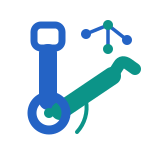
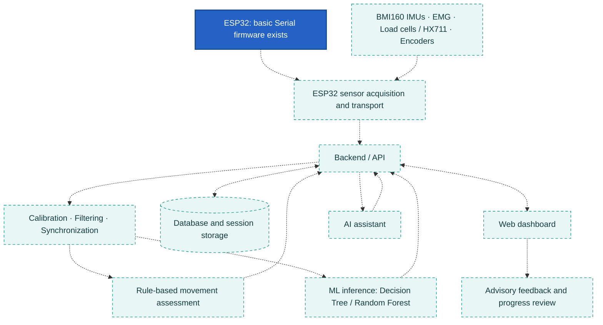

<div align="center">
  
  <h1>ModuRehab Home</h1>
  <p><strong>Measure movement. Understand progress.</strong></p>
  <p>An AI-Enabled, Modular Upper-Limb Rehabilitation Platform<br>for Clinic-to-Home Therapy.</p>
  <p>A university Cyber Physical Systems project connecting modular rehabilitation<br>hardware, multimodal sensing, and planned movement-quality feedback.</p>
  <p>
    
    
    
  </p>
  <p>
    
    
    
    
  </p>
  <p>
    <a href="#architecture">Architecture</a> ·
    <a href="#roadmap">Roadmap</a> ·
    <a href="#getting-started">Getting started</a> ·
    <a href="docs/README.md">Project documentation</a>
  </p>
</div>

> **Prototype status:** the repository structure, PlatformIO configuration, and
> basic ESP32 Serial sketch are prepared. The sketch was compiled during initial
> setup; physical upload and hardware operation remain unconfirmed. Sensing,
> rehabilitation applications, and AI/ML are planned, not working features.

---

## 🦾 Introduction

ModuRehab Home explores a modular approach to elbow and wrist rehabilitation.
The proposed platform brings together joint motion, muscle activity, and
interaction-force measurements so exercise sessions can be reviewed in context.

The clinic-to-home goal is to support therapist-configured exercises, useful
feedback during practice, and clearer progress review. These are engineering
objectives; therapeutic benefit and suitability for home use have not been
validated.

## Problem statement

During home exercises, users may lack immediate feedback about how a movement
was performed, while therapists may have limited visibility between visits.
Counting repetitions alone does not describe movement quality, muscle activity,
or interaction force.

The project asks how a modular device can capture these complementary signals
and present understandable session information while preserving safety,
measurement quality, and privacy.

## Our solution

The proposed device will use modular attachments for elbow and wrist exercises,
an ESP32 controller, and complementary sensors. A processing pipeline will turn
calibrated measurements into session summaries and movement-quality indicators.
A future dashboard will support therapist configuration and progress review.

Offline-first operation is a design goal: essential local behavior should remain
available without cloud inference. Recording, buffering, reconnection, and later
synchronization still require design and implementation. Bounded motor assistance
is a future possibility only, subject to independent safety validation.

---

## ✨ Key features

**All rehabilitation capabilities below are proposed.** Only the basic Serial
firmware and repository foundation exist today.

| Feature group | Intended capability |
| --- | --- |
| **Motion tracking** | BMI160 inertial measurements and joint encoders for elbow/wrist movement analysis. |
| **Muscle activity** | Surface EMG acquisition and signal-quality assessment. |
| **Force measurement** | Calibrated load-cell measurements through HX711 acquisition. |
| **Movement quality** | Rule-based assessment followed by evaluated ML approaches. |
| **AI-assisted feedback** | Advisory explanations based on authorized session summaries. |
| **Session monitoring** | Therapist-configured exercises, session visualization, and progress review. |
| **Offline-first operation** | Local behavior and future recording/synchronization without cloud-dependent safety. |

<a id="architecture"></a>

## 🔗 System architecture

This is the **planned data flow**, not a deployed system. Solid blue identifies
existing basic firmware; dashed teal components represent planned work. All
connections are proposed.



The backend will coordinate measurement validation, processing, storage, and
application access. Model results and assistant explanations will return through
backend interfaces. No direct AI-to-actuator control is proposed here.

Protocols, schemas, storage technology, and application frameworks remain
undecided. See the [architecture document](docs/design/software-architecture.md).
The GitHub Pages website is public documentation, separate from the future
rehabilitation dashboard and backend.

---

## Hardware components

| Component | Proposed purpose | Current evidence |
| --- | --- | --- |
| **ESP32** | Coordinate acquisition, timestamps, and local device behavior. | Generic `esp32dev` configuration and basic Serial sketch; physical board not confirmed. |
| **BMI160 IMUs** | Inertial motion tracking. | Planned; no driver integration. |
| **Surface EMG sensors** | Muscle-activity acquisition. | Planned; no acquisition code. |
| **Load cells + HX711** | Interaction-force measurement. | Planned; no acquisition code or calibration results. |
| **Joint encoders** | Elbow and wrist movement measurement. | Included in the planned design; no integration code. |
| **Modular attachments** | Adapt mechanical setup to exercise scenarios. | Design planning; no completed CAD, schematic, or PCB artifacts. |

Sensor quantities, exact pin mappings, operating ratings, and mechanical limits
are not confirmed. Reusable drivers belong in `firmware/esp32/lib/`; pin and
configuration declarations belong in `firmware/esp32/include/`.

## Software and AI

| Component | Planned role | Status |
| --- | --- | --- |
| ESP32 firmware | Acquisition, synchronization support, local behavior, and transport. | Serial-only sketch implemented. |
| Data processing | Calibration, filtering, synchronized features, and offline analysis. | Placeholder directory. |
| Backend | Device ingestion, session management, storage integration, and APIs. | Structure and README only. |
| Web dashboard | Exercise setup, visualization, and progress monitoring. | Structure and README only. |
| Machine learning | Train, evaluate, and integrate movement-quality models. | Placeholder directory; no trained models. |
| AI assistant | Explain authorized summaries and assist users/therapists. | Placeholder directory; no integration. |

**Planned assessment progression:** begin with rule-based movement assessment,
then train a small **Decision Tree**, and compare it with a **Random Forest**.
Use held-out data and documented metrics to compare methods rather than assuming
that a more complex model is better. No datasets, validated labels, models, or
performance claims are available yet.

The assistant will provide advisory explanations through the backend. It will
not diagnose, prescribe treatment, or override independent safety controls.

---

## Repository structure

The tree below reflects the current layout; empty directories contain `.gitkeep`
files, omitted here for readability. No generated build directories are shown.

```text
e22-3yp-Modu-Rehab-Home/
├── README.md
├── .gitignore
├── firmware/
│   └── esp32/
│       ├── platformio.ini
│       ├── src/main.cpp
│       ├── include/
│       ├── lib/
│       └── test/
├── software/
│   ├── web_dashboard/
│   │   ├── README.md
│   │   └── frontend/
│   ├── backend/
│   │   ├── README.md
│   │   ├── app/
│   │   └── tests/
│   ├── data_processing/
│   ├── ml/
│   └── ai_assistant/
├── hardware/
│   ├── cad/
│   ├── schematics/
│   ├── pcb/
│   └── mechanical/
├── tests/
│   ├── sensors/
│   └── system/
└── docs/
    ├── README.md
    ├── _config.yml
    ├── .gitignore
    ├── assets/
    │   ├── css/
    │   ├── js/
    │   └── images/
    │       ├── modurehab-icon.svg
    │       └── modurehab-logo.svg
    ├── pages/
    ├── images/sample.png
    ├── data/index.json
    ├── design/software-architecture.md
    └── reports/
```

| Area | Where new work belongs |
| --- | --- |
| Embedded | `src/` for application code, `include/` for shared headers, `lib/` for reusable drivers, and `test/` for firmware tests inside `firmware/esp32/`. |
| Rehabilitation software | Frontend in `software/web_dashboard/frontend/`; backend in `software/backend/app/`, with tests in `software/backend/tests/`. |
| Analysis and intelligence | Processing, ML, and assistant code in their respective `software/` directories. |
| Hardware | Models in `hardware/cad/`, circuits in `schematics/`, boards in `pcb/`, and mechanical details in `mechanical/`. |
| Verification | Sensor procedures in `tests/sensors/`; end-to-end checks in `tests/system/`. |
| Documentation | Diagrams in `docs/design/`, reports in `docs/reports/`, and images in `docs/images/` or `docs/assets/images/`. |

<a id="roadmap"></a>

## 🗺️ Development roadmap

| Phase | Work | Status |
| --- | --- | --- |
| Foundation | Repository organization, PlatformIO configuration, Serial sketch, initial architecture documentation, and SVG identity. | **Prepared**; sketch compiled during setup. |
| Design planning | Refine system interfaces, mechanical attachments, and electronics. | **Ongoing planning**; no completed hardware artifacts. |
| Board verification | Confirm physical ESP32 model, upload, and verify Serial behavior. | **Pending**. |
| Individual sensing | One BMI160 → multiple IMUs → load cell/HX711 → encoders → EMG. | **Planned**. |
| Measurement pipeline | Calibration, synchronization, filtering, and reference comparisons. | **Planned**. |
| Rehabilitation application | Backend, session storage, dashboard, and offline behavior. | **Planned**. |
| Assessment and assistance | Rule-based baseline → Decision Tree → Random Forest comparison; bounded AI explanations. | **Planned**. |
| Integrated evaluation | Reliability, measurement quality, and independent safety verification. | **Future work**; no integrated test results. |
| Bounded motor assistance | Explore only after suitable mechanical/electrical safety validation and oversight. | **Future possibility**, not implemented. |

No dates or clinical milestones are claimed. A successful compilation does not
establish physical operation, measurement accuracy, or therapeutic benefit.

---

## Safety and limitations

**ModuRehab Home is a development prototype, not a clinically validated medical
device.** AI must not diagnose conditions, prescribe treatment, or override
independent safety mechanisms.

- Do not test powered movement on a person during early development.
- Motorized assistance is future work. It requires validated travel/load limits,
  emergency stop, independent protections, and clinical supervision.
- Human or patient testing requires appropriate institutional approval and
  mechanical/electrical validation before use.
- Safety-critical behavior must remain independent of AI inference and network
  connectivity; these protections are requirements, not implemented features.
- Sensor calibration, synchronization, privacy, and offline operation remain
  development tasks. Never commit credentials or personal patient data.

## Team

| Team member | Registration number | Email |
| --- | --- | --- |
| R.G.S.T.Weerasekara | E/22/419 | [e22419@eng.pdn.ac.lk](mailto:e22419@eng.pdn.ac.lk) |
| K.H.D.M.Bimsara | E/22/052 | [e22052@eng.pdn.ac.lk](mailto:e22052@eng.pdn.ac.lk) |
| M.M.T.Cooray | E/22/058 | [e22058@eng.pdn.ac.lk](mailto:e22058@eng.pdn.ac.lk) |
| S.I.Gunawardhana | E/22/127 | [e22127@eng.pdn.ac.lk](mailto:e22058@eng.pdn.ac.lk) |

Names are preserved from existing project documentation. Supervisor details and
individual roles have not been confirmed. `docs/data/index.json` still contains
template entries and has not been synchronized.

---

<a id="getting-started"></a>

## 🚀 Getting started

### ESP32 firmware

1. Install VS Code and the PlatformIO IDE extension.
2. Open **`firmware/esp32/`** as the existing PlatformIO project; do not create a
   second nested project.
3. Open a PlatformIO terminal. Compilation needs no physical board; upload and
   Serial monitoring need a compatible ESP32 and a USB **data** cable.

The [current configuration](firmware/esp32/platformio.ini) is:

```ini
[env:esp32dev]
platform = espressif32
board = esp32dev
framework = arduino
monitor_speed = 115200
```

From `firmware/esp32/`, build without uploading:

```sh
pio run --environment esp32dev
```

The first build may download the required Arduino framework and toolchain. No
sensor libraries are currently declared. `.pio/` build output is ignored by Git.

<details>
<summary><strong>Windows: if PowerShell cannot find pio</strong></summary>

Use a PlatformIO terminal, or the default bundled executable if installed there:

```powershell
& "$env:USERPROFILE\.platformio\penv\Scripts\platformio.exe" run --environment esp32dev
```

The same executable accepts the remaining PlatformIO arguments below.

</details>

<details>
<summary><strong>Upload and Serial Monitor — only after confirming the board</strong></summary>

`esp32dev` is a temporary generic configuration. Confirm the actual physical
board model and its compatibility, then identify its port:

```sh
pio device list
```

Replace `COM_PORT` with the actual Windows COM port or device path on another OS:

```sh
pio run --environment esp32dev --target upload --upload-port COM_PORT
pio device monitor --environment esp32dev --port COM_PORT --baud 115200
```

The current sketch prints `ModuRehab ESP32 Starting` at startup and
`ESP32 is working!` every second. The startup line may be missed if the monitor
opens later. Exit with `Ctrl+C`; close the monitor before uploading if it holds
the port. These commands are instructions, not confirmation of a hardware test.

</details>

### Application software

The [dashboard](software/web_dashboard/README.md) and
[backend](software/backend/README.md) have directory structures and READMEs only.
Frontend/backend frameworks, database technology, and dependencies remain
undecided. There are no application run scripts, API endpoints, or ML setup
commands to run yet.

<details>
<summary><strong>Contributor workflow, conventions, and testing</strong></summary>

Clone the repository and read the subsystem documentation before editing:

```sh
git clone https://github.com/cepdnaclk/e22-3yp-Modu-Rehab-Home.git
cd e22-3yp-Modu-Rehab-Home
git status
git switch -c feature/imu-acquisition
```

`git status` shows existing work; preserve it. `git switch -c` creates a new
branch. Use `feature/...`, `fix/...`, `docs/...`, or `test/...` names.

Keep modules small, use meaningful names, comment non-obvious logic, and separate
sensor drivers from application behavior. Keep pin assignments organized and
add tests when introducing functionality. No additional style tooling is required.

Work in the relevant subsystem, validate locally, and update documentation.
Review and stage only intended files; substitute an actual path below:

```sh
git diff
git diff --check
git add path/to/changed-file
git diff --cached
git commit -m "feat: describe the completed change"
git push -u origin feature/imu-acquisition
```

`git add` stages files, `git diff --cached` reviews that snapshot, and `git commit`
records it locally. Ordinary `git diff` does not show untracked files, so inspect
new files too. Push only with appropriate repository access, then open a pull
request for review, normally targeting `main`. Use an authorized fork if needed.
Commit prefixes: `feat:`, `fix:`, `docs:`, `test:`, `refactor:`, and `chore:`.

Validate sensors individually before integration. Record wiring, units, sample
rates, reference comparisons, calibration error, and repeatability. Test force
against known loads and EMG for signal quality. Evaluate ML against rule-based
baselines on held-out data. Later system tests should cover timing, missing data,
connectivity failures, and independent protections.

No automated sensor, backend, or integrated system test suite exists yet. Report
the checks performed and their limits. Never commit build output, virtual
environments, temporary files, secrets, or private rehabilitation data.

</details>

---

## Project links

- [Repository](https://github.com/cepdnaclk/e22-3yp-Modu-Rehab-Home)
- [Project homepage source](docs/README.md)
- [GitHub Pages address](https://cepdnaclk.github.io/e22-3yp-Modu-Rehab-Home/) — intended address; deployment is not verified here.
- [Software architecture](docs/design/software-architecture.md)
- [Project reports](docs/reports/) — reports pending.
- [Project metadata](docs/data/index.json) — template entries remain.
- [Horizontal SVG logo](docs/assets/images/modurehab-logo.svg)
- [PlatformIO quick start](https://docs.platformio.org/en/latest/core/quickstart.html)
- [Department of Computer Engineering](http://www.ce.pdn.ac.lk/)
- [Faculty of Engineering, University of Peradeniya](https://eng.pdn.ac.lk/)

<div align="center">
  <sub>Modular sensing · Measured movement · Responsible engineering</sub>
</div>
